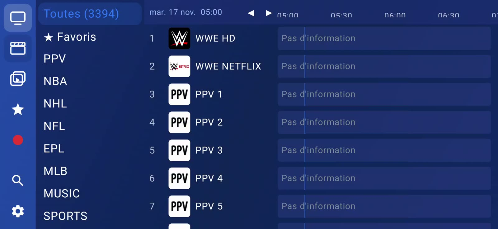
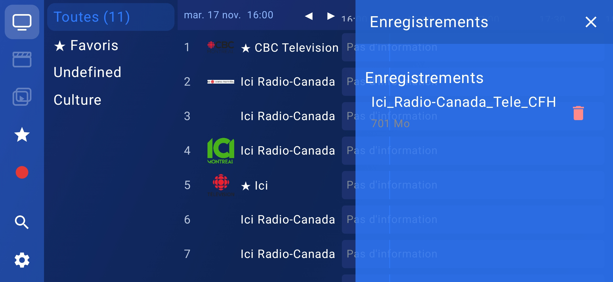
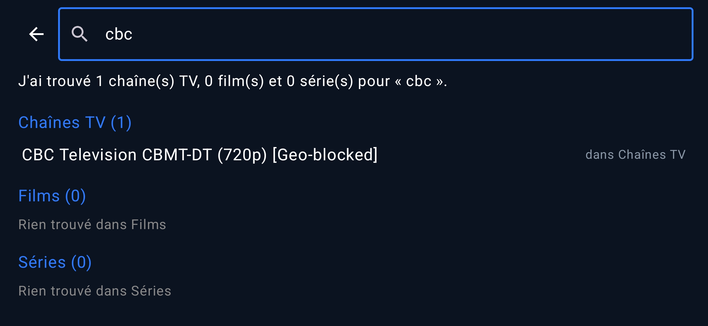

# theIPTVapp — Android et Google TV

Lecteur IPTV pour **téléphone Android** et **Google TV / Android TV**. C'est la version Android de theIPTVapp (Windows).
Une seule application : tactile sur téléphone, télécommande (flèches, OK, Retour) sur la télé.

*Créé par Benoît Dumont avec l'aide de l'IA, Studio Gyro. theIPTVapp est un lecteur : il ne fournit aucune chaîne.*

## Aperçu

| TV et guide | Enregistrements | Recherche |
|---|---|---|
|  |  |  |

## Fonctions

**Sources et navigation**
- Sources **M3U** (adresse web) et **Xtream Codes**. Plusieurs listes, modifiables à tout moment.
- **TV, Films, Séries** : colonne de gauche, catégories, puis liste ou murs d'affiches en plein écran.
- **Ma liste** : favoris de la TV, des films et des séries. **Enregistrements** : accès direct depuis la colonne.
- **Recherche** dans sa propre fenêtre : TV, Films et Séries à la fois.

**Lecteur**
- Media3 / ExoPlayer (HLS, TS, AC-3, HEVC selon l'appareil).
- Barre de contrôle : recule, pause, avance, retour au direct, chaîne précédente et suivante, enregistrement, favori.
- **Multi-vue** : jusqu'à 4 chaînes en direct côte à côte.
- Sauts dans le temps réglables (barre de progression, RW, FF), taille de la mémoire tampon, lecture en tunnel.
- **Lecteur externe** (option) : la chaîne s'ouvre dans VLC s'il est installé, sinon dans l'appli de ton choix.
- Historique des chaînes, menu d'options (image dans l'image, résolution, sous-titres, audio, minuterie).

**Sous-titres**
- Films et séries : pistes intégrées au fichier, ou fichier `.srt` / `.vtt` chargé par adresse.
- TV en direct : seulement si le flux contient des sous-titres.
- Recherche en ligne (OpenSubtitles) en français et en anglais. Mets ta clé personnelle, gratuite et à créer sur opensubtitles.com, dans Préférences › Réseau. Elle reste sur l'appareil.

**Guide et enregistrements**
- **Guide EPG** (Xtream) en grille, avec rappels d'émissions.
- **Enregistrement** des chaînes en direct, et DVR (2 h) pour revenir en arrière dans le direct.
- Reprise de lecture des films et épisodes ; saisons et épisodes.

**Réglages** (panneau qui glisse par-dessus l'interface)
- Apparence : taille du texte, couleurs, surbrillance, image de fond, transparence.
- Profils avec code à 4 chiffres, groupes masquables ou verrouillables, contrôle parental.
- Réseau (User-Agent, proxy), sauvegarde et restauration (fichier dans Téléchargements), mises à jour.

**Ouverture**
- Animation d'ouverture avec le logo, qui s'efface quand la liste est chargée.

## Installer
1. Onglet **Actions**, puis la dernière exécution verte, puis l'artefact **theIPTVapp-debug-apk**.
2. Décompresser, puis installer `app-debug.apk`.

Il faut autoriser les « sources inconnues ». Sur Google TV, copie le fichier sur une clé USB ou passe par une appli de transfert de fichiers.

## Construire soi-même
Ouvre le dossier dans Android Studio, ou lance `gradle assembleDebug` (Gradle 8.10, JDK 17, Android SDK 35).

## Structure du code
| Fichier | Rôle |
|---|---|
| `Ui.kt` | Accueil, colonnes, réglages, recherche |
| `Player.kt` | Lecteur, barre de contrôle, menus |
| `MultiView.kt` | Multi-vue (4 lecteurs au maximum) |
| `MainVm.kt` | État de l'appli, listes, guide, enregistrements |
| `Store.kt` | Réglages sauvegardés sur l'appareil |
| `Splash.kt` | Animation d'ouverture |

## Mises à jour
L'appli vérifie les nouvelles versions (GitHub Releases) au démarrage. Préférences › Mises à jour permet de vérifier à la main.

## Confidentialité et conditions
Les conditions d'utilisation et la politique de confidentialité sont dans l'appli (À propos). Elles sont en cours de relecture.
